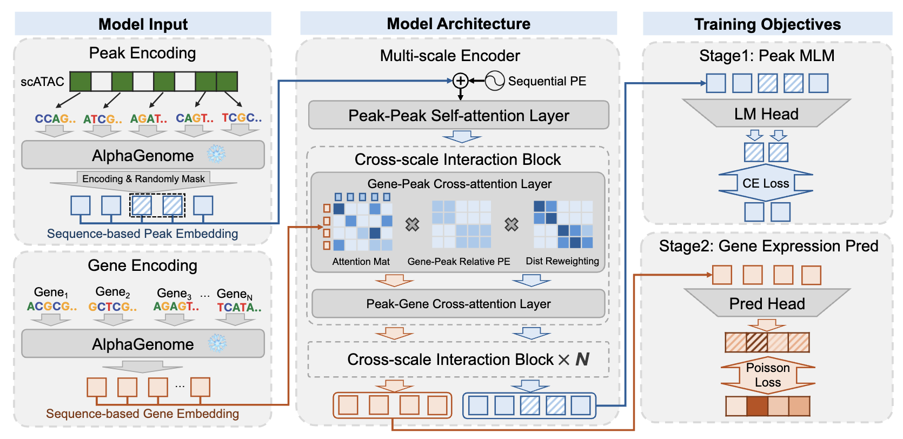

# MUSS

Official code repository for **MUSS: A Multi-scale and Sequence-based Model for Single-cell Gene Regulation** (NeurIPS 2026).

MUSS predicts gene expression from single-cell chromatin accessibility and DNA sequence
embeddings. This repository provides data preprocessing, fine-tuning
from the released encoder, and evaluation on PBMC10K, BMMC, Open Problems and HCA bone.



## Documentation

| Guide | Contents |
|---|---|
| [Reproduction](docs/reproduction.md) | Installation, downloads, preprocessing, fine-tuning and evaluation commands |
| [Training settings](docs/settings.md) | Dataset budgets, optimizer, data splits and device configuration |
| [Metric definitions](docs/metrics.md) | Expression prediction and cell-clustering metrics |
| [Reference results](docs/results.md) | Scores from the released models |

## Data and checkpoints

- [MUSS-data on Hugging Face](https://huggingface.co/datasets/kangjiezheng/MUSS-data): PBMC and HCA bone inputs in `raw/`, with genome and gene references in `reference/`.
- [MUSS on Hugging Face](https://huggingface.co/kangjiezheng/MUSS): the released encoder in `checkpoints/pretrain/` and four downstream models in `checkpoints/finetune/`.

Follow the [download instructions](docs/reproduction.md#download-data-and-checkpoints) to
place both repositories in `MUSS_ASSETS`. BMMC and Open Problems inputs come from their
original sources, linked in the guide.

## Environment setup

[Create the environment](docs/reproduction.md#environment-setup) and install the package.
The pinned environment uses Python 3.10, PyTorch 2.8 and Lightning 2.5.6.

## Data preprocessing

**Preprocess every dataset before training or evaluation, including with released checkpoints.**
Build PBMC first to obtain the shared gene panel and gene embeddings, then build the datasets
you need. See the [preprocessing commands](docs/reproduction.md#data-preprocessing).

## Fine-tuning

Start from the released `muss_pretrain.pt` encoder and fine-tune with
[scripts/finetune.py](scripts/finetune.py). The script selects the reference settings for each
dataset and saves portable model weights plus a checkpoint for resuming training.

See [fine-tuning and resume commands](docs/reproduction.md#fine-tuning). You can also use
[released downstream checkpoints](https://huggingface.co/kangjiezheng/MUSS/tree/main/checkpoints/finetune)
to proceed directly to evaluation after preprocessing.

## Evaluation

Evaluate released or newly fine-tuned models with the
[gene-expression prediction commands](docs/reproduction.md#gene-expression-prediction).
The released encoder also supports [zero-shot cell clustering](docs/reproduction.md#zero-shot-cell-clustering).
Compare the output tables with the [reference results](docs/results.md).

## License

Code: [MIT](LICENSE). Datasets retain their source terms. AlphaGenome weights and sequence
embeddings are subject to the applicable [model terms](https://deepmind.google.com/science/alphagenome/model-terms)
and [output terms](https://deepmind.google.com/science/alphagenome/output-terms).

## Citation

If you find MUSS useful in your research, please cite our paper:

```bibtex
@inproceedings{zheng2026muss,
  title = {{MUSS}: A Multi-scale and Sequence-based Model for Single-cell Gene Regulation},
  author = {Kangjie Zheng and Amirhossein Vahidi and Liying Jin and Joseph Clarke
            and {Vijaya Baskar MS} and Connor Rogerson and Mengji Zhang
            and Muzlifah Haniffa and Anshul Kundaje and Mohammad Lotfollahi},
  booktitle = {Advances in Neural Information Processing Systems (NeurIPS)},
  year = {2026}
}
```
